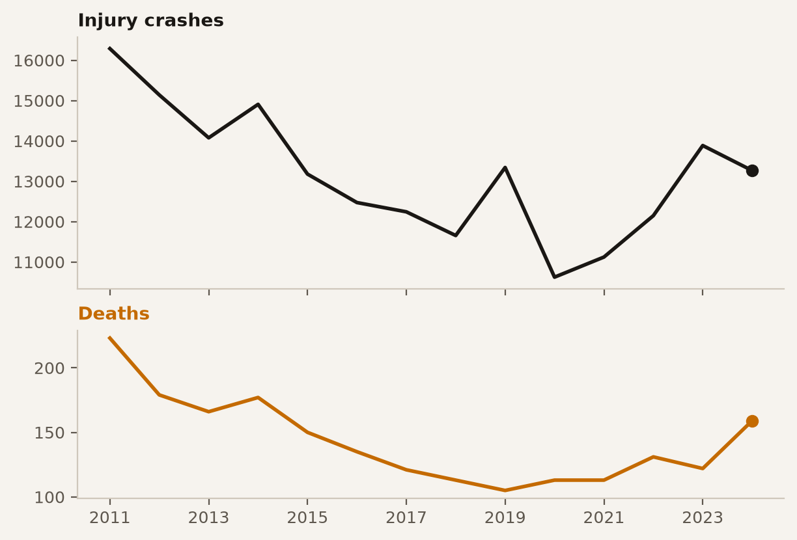
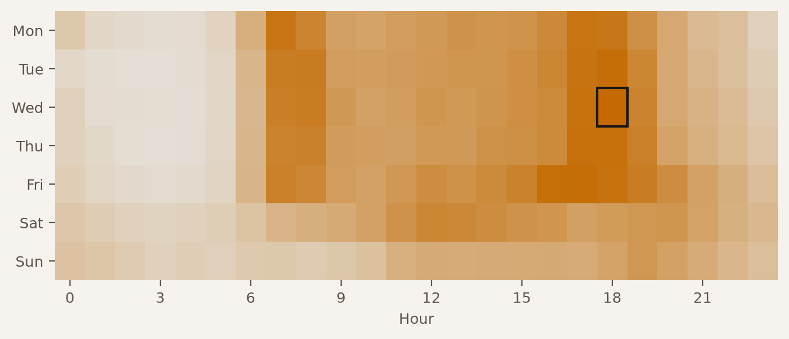
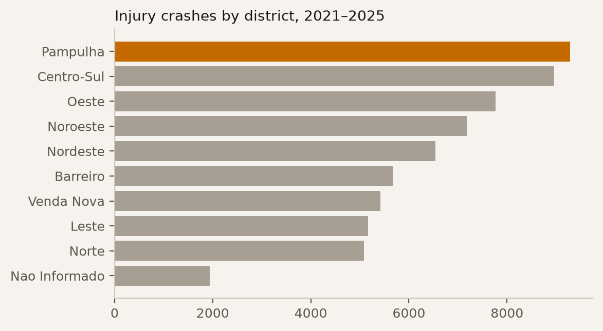
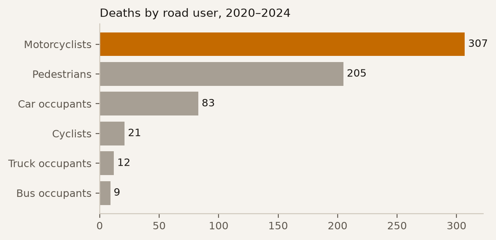
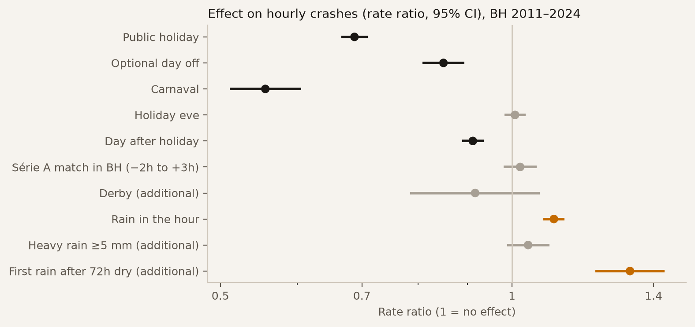
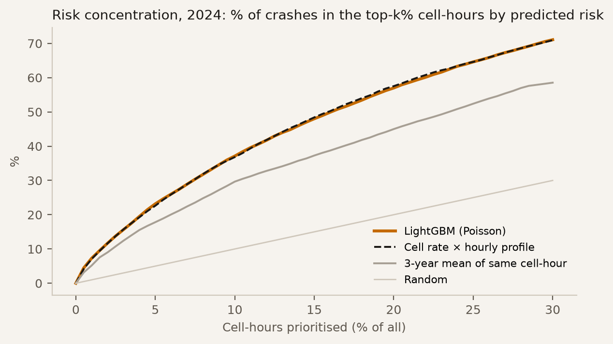
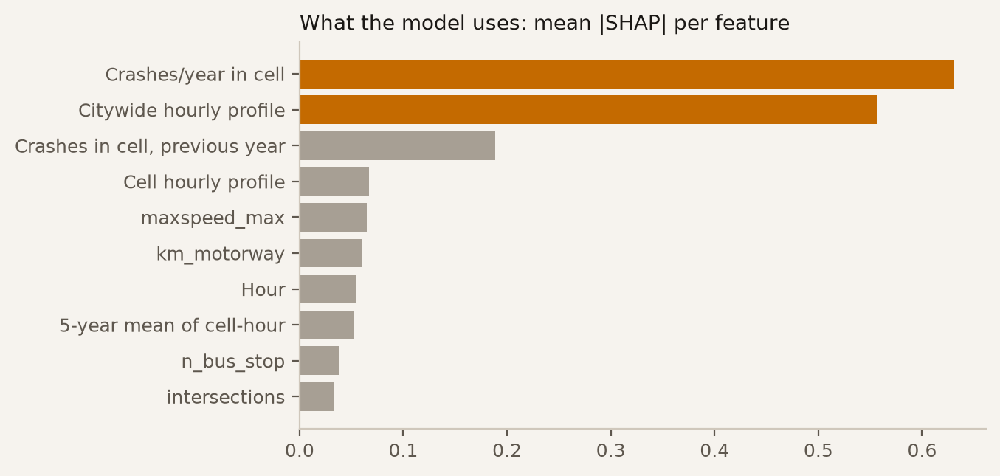
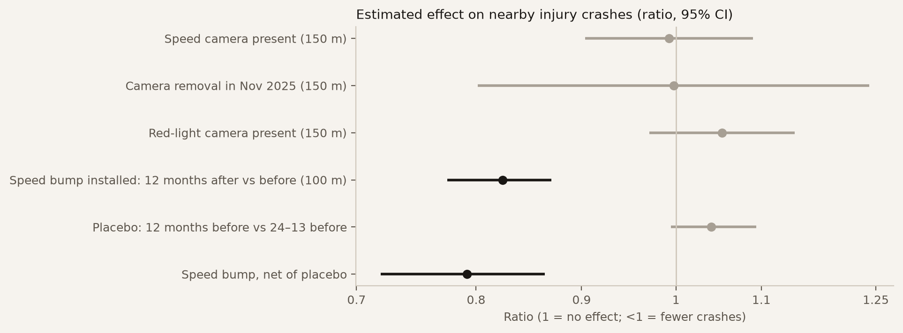

> **Status:** draft. Sections marked *planned* describe methods, not results.
> Numbers generated by `bhtraffic.export.site` and `bhtraffic.viz.figures` on 2026-10-13.

# Introduction

In 2025 Belo Horizonte recorded **13,887 traffic crashes with victims — 38 per day** —, the most since 2014,
and **148 fatal crashes**; 2024 had 154, the most since 2014. This work has two goals: (i) build a reproducible diagnosis of traffic in the
city and its metropolitan region (RMBH), segmented by area, time and road-user type; and (ii) evaluate
machine-learning interventions on real data and in simulation.

# Data

| Source | Period | Use |
|---|---|---|
| Injury crashes — crashes, vehicles and people [@pbh_sinistros] | 2011–2024 | who, vehicle mix |
| Injury crashes — monthly geolocated dataset (city) | 2016–Jul 2026 | diagnosis, risk, interventions |
| Enforcement devices — 51 monthly snapshots (city) | Jun 2022–Sep 2026 | camera presence per site |
| Speed bumps (city) | installed 2006–2025 | before/after |
| Radar volumetric counts [@pbh_radares] | 2021–2023 | volume, speed, vehicle mix |
| Real-time bus GPS (city) | own collection | commercial speed |
| TomTom Routing | own collection (free tier) | travel time per corridor |
| OpenStreetMap; H3 grid res. 8 [@h3] | 2026 snapshot | road network, spatial aggregation |
| INMET, station A521 Pampulha [@inmet] | 2011–2026, hourly | rain |
| National, MG and BH holidays (`holidays` package + municipal law) | 2011–2026 | calendar |
| Brasileirão Série A [@brasileirao_dataset] | 2012–2024 | matches in BH |

Data handling is documented in `docs/data_audit.md`. Notably: unifying column names that drift across years;
converting 2011–2015 coordinates to the later UTM layout; and removing from the map 6,618 records with a default
geocode (a single spot attributed to five or more districts).

# Preliminary diagnosis

## The decade

{#fig-yearly}

Injury crashes fell from 16,288 (2011) to 10,623 (2020) and have risen since, reaching 13,887 in 2025.
Fatal crashes (at least one death) bottomed at 98 in 2019, rose to 154 in 2024 and were 148 in 2025 (@fig-yearly).
The series counts fatal crashes, not deaths, because the monthly dataset (2016 on) has no people involved;
for 2016–2024 both datasets match record by record.

## When

{#fig-clock}

Monday to Friday, crashes cluster in two peaks — **7:00 and 18:00** — matching commuting. The worst hour of the
week is **Wednesday at 18:00**, with 833 crashes over five years (@fig-clock).

## Where

{#fig-regionals}

In 2021–2025 **Pampulha now leads** in both injury crashes (9,283, against 8,963 in Centro-Sul) and fatal crashes
(111, against 54).
Pampulha's worst hexagon sits on Av. Antônio Carlos (@fig-regionals).

## Who

{#fig-users}

**75% of injury crashes involve at least one motorcycle.** Of the 638 deaths in 2020–2024, motorcyclists (48%)
and pedestrians (32%) account for 80% (@fig-users).

**Exposure (preliminary).** In the first sample of BHTrans radar data — 10 days of August 2021, 88 locations,
12.4 million detected vehicles — motorcycles are **12.5%** of traffic. The gap between presence in traffic and
presence in injury crashes is the starting point for the risk model. Caveats: short sample, and radar classification
may undercount motorcycles riding between lanes.

# Congestion at radar sites (preliminary)

For each BHTrans radar, free-flow speed is the median car mean speed between 00:00 and 05:00; the **speed index**
is each hour's speed divided by it (1 = free flow; < 0.7 = congested). In the sample available — **10 days of August
2021, 88 radars**, still under pandemic conditions — the worst weekday sites are Av. Cristiano Machado by the Paulo
Mendes Campos viaduct (index 0.36 at 17h), Av. Raja Gabaglia (0.31 at 18h), Av. Teresa Cristina (0.39 at 17h) and,
in the morning peak, Andradas, Amazonas and Antônio Carlos. These will be recomputed with all 31 months of radar data
(Mar 2021–Sep 2023) and should not be read as a final ranking.

# When risk changes: holidays, matches and rain

**Design.** One row per hour, 2011 to July 2026 (136,584 hours, 205,994 crashes with a reported time). Poisson GLM (standard errors clustered by day, robust to overdispersion) with
fixed effects for weekday × hour (168), month, year and the pandemic restriction period (2020-03-18 to 2021-06-30).
Each coefficient is a **rate ratio** (RR) against comparable hours without the event. National, Minas Gerais and BH
municipal holidays; Série A matches at BH stadiums (2012–2024, 310 matches, 19 derbies; window from 2 h before to 3 h after
kickoff); hourly rain from INMET station A521 (Pampulha), aligned to the hour it fell (INMET records the total of the hour ending at the timestamp).

{#fig-effects}

- **Rain:** an hour with rain has **+13.6%** crashes (RR 1.136; 95% CI 1.10–1.17). The **first rain after 72 h of dry
  weather** adds **+19%** (RR 1.19; 1.09–1.30), ≈ +35% in total — consistent with the oil-and-dust film on the road.
  Heavy rain (≥ 5 mm) adds nothing beyond that.
- **Holidays:** −31% (RR 0.69); Carnaval −44%; optional days off −15%; the day after a holiday −10%. Holiday eves do
  not differ from a normal day.
- **Matches** (2012–2024, the period the match data covers): **no detectable effect** citywide (RR 1.02; 0.98–1.06) or within 1.5 km of the stadiums (Mineirão
  RR 1.03; 0.73–1.46; Independência RR 1.00; 0.61–1.63 — wide intervals: 33 and 20 crashes in match windows;
  Arena MRV, opened in 2023, does not have enough data yet).

**Caution.** Fewer crashes on holidays mostly reflects **less traffic**, not safer streets per vehicle; radar volumes
will separate exposure from risk. Match data covers Série A only: the state league, Copa do Brasil, Libertadores and
Série B (Cruzeiro in 2020–2022) are missing, which dilutes any effect.

# Crash risk

**Question.** How many injury crashes to expect in each H3 hexagon (res. 8, ~0.7 km²) in each hour of the week?
**Design.** 429 cells × 7 days × 24 h = 72,072 cell-hours. Features use only years before the target year
(no leakage): training predicts 2024 from 2019–2023 history; **testing predicts 2025** from 2020–2024 history.
Crashes without coordinates, without time, or at the default geocoding spot are excluded (13,403 remain in 2025).
**Models.** LightGBM with Poisson loss [@ke2017lightgbm], with history (v0) and with 14 OpenStreetMap road features
chosen before looking at the test year (v1), against two baselines: (a) 3-year mean of the same cell-hour; (b) the
cell's yearly rate × the citywide hourly profile.

{#fig-risk-capture}

| 2025 (test) | Top 1% | Top 5% | Top 10% | Poisson deviance |
|---|---|---|---|---|
| LightGBM v1 (history + OSM) | 6.9% | 23.2% | 37.4% | 0.522 |
| LightGBM v0 (history) | 6.8% | 23.1% | 37.5% | 0.523 |
| Cell rate × hourly profile | 6.8% | 22.7% | 37.1% | 0.537 |
| 3-year mean of cell-hour | 5.2% | 17.7% | 28.8% | 3.29¹ |

: Share of 2025 crashes captured when prioritising the top-k% cell-hours by predicted risk. ¹ Inflated by zero predictions in cell-hours with no history. {#tbl-risk}

**Result.** Risk is concentrated: **5% of cell-hours hold 23% of crashes** (4.6× chance), 10% hold 37%
(@fig-risk-capture). In 2025 LightGBM **fits better** than baseline (b) — 95% CI of the deviance difference
[−0.020, −0.011], cell-block bootstrap with 500 replicates — but **ties on the prioritisation metric**: top-5% capture
[−0.2, +0.9] pp. Tested earlier on 2024, it tied on both. OSM road features (v1) add nothing to history (difference
to v0: deviance [−0.002, +0.000], top 5% [−0.3, +0.4] pp). Risk is almost separable into *where* × *when*; SHAP agrees:
cell rate and hourly profile dominate (@fig-risk-shap).

{#fig-risk-shap}

**Implication.** To choose *where* to act, a transparent ranking (rate × profile) is enough; the model helps estimate
*how much* to expect. Real prioritisation gains should come from **exposure** (radar volumes and speeds) and measured
interventions (next section), not from a bigger model.

# Speed cameras and speed bumps: what changed near them

**Data.** The city publishes enforcement-device locations in monthly snapshots (51 since June 2022) and the
installation date of every speed bump. Devices of one family within 50 m form a *site*; each site's presence is
tracked month by month. Between October and November 2025 the registry fell from 669 to 163 devices (speed cameras:
142 → 66) and was rebuilt during 2026, often at other locations — consistent with a contract change, not confirmed here.

**Design (fixed before results).** Cameras: site × month panel (Jun 2022–Jul 2026), outcome = injury crashes within
150 m; Poisson with site and month fixed effects (absorbing rain, holidays and the citywide trend), SEs clustered by
site; the effect is identified by sites that gained or lost a device. Event study of the Nov 2025 removal (sites that
lost their camera × sites that kept it). Speed bumps: crashes within 100 m in the 12 months after × 12 months before
installation, each window relative to the citywide total in the same months (ratio of ratios), with a *placebo* one
window earlier (24–13 × 12–1 months before) to measure regression to the mean when bumps follow a spike.

{#fig-interventions}

| Intervention | Sites | Effect (95% CI) |
|---|---|---|
| Speed camera present | 144 (116 changed) | ×0.99 [0.90–1.09] |
| Camera removal in Nov 2025 (DiD) | 72 lost × 29 kept | ×1.00 [0.80–1.24] |
| Red-light camera present | 123 | ×1.05 [0.97–1.14] |
| Speed bump: after × before | 2,618 (2013–2025) | ×0.82 [0.77–0.87] |
| Speed bump: placebo (before × earlier) | | ×1.04 [0.99–1.09] |
| **Speed bump, net of placebo** | | **×0.79 [0.72–0.86]** |

: Effect on nearby injury crashes (cameras 150 m; bumps 100 m), Jun 2022–Jul 2026 (cameras) and 2012–Jul 2026 (bumps). {#tbl-enf}

**Result.** **Speed bumps** are associated with **about 21% fewer injury crashes** within 100 m (@fig-interventions),
and the placebo shows only a small, non-significant rise before installation — the drop is not explained by
regression to the mean. For **speed cameras** and **red-light cameras**, the effect is indistinguishable from zero at
the 150 m scale; the mass removal of Nov 2025 showed no detectable worsening over 9 months either. That last reading is
**fragile**: the event study rejects parallel pre-trends (p = 0.015), and the registry shows where a device is
listed, not whether it was issuing fines.

**Robustness.** (i) In 2024 the city stopped using default geocodes (until 2023 hundreds of crashes a year sat on one
spot of the Anel; see `docs/data_audit.md`). Restricted to the period with consistent geocoding (2024 on), the speed
camera effect is ×0.92 [0.83–1.01] (p = 0.07): a hint of reduction, not significant. For speed bumps,
using only windows entirely on one side of the change: ×0.80 [0.72–0.89].
(ii) The speed-bump interval comes from a bootstrap over operational projects (2,168 groups; bumps without a
project grouped within 200 m), because bumps of one project sit on one street and their buffers overlap.

**Caution.** No detectable effect is not proof of no effect: cameras act on speed along longer stretches and on crash
severity (not only counts), and a 150 m radius may miss that. Speeds measured by the BHTrans radars (being processed)
will allow testing the effect on speed directly.

# Machine-learning methods (planned)

1. **Congestion forecasting.** Spatio-temporal graph networks [@li2018dcrnn; @yu2018stgcn; @wu2019graphwavenet]
   predicting per-segment speed 15–60 min ahead from radars, TomTom and bus GPS. Baselines: historical mean per
   segment × hour and a seasonal naive model. Walk-forward validation.
2. **Crash risk (v1).** Same design as the previous section, explained with SHAP [@lundberg2017shap],
   adding exposure (radars, TomTom) and road-geometry (OSM) features.
3. **Adaptive signals.** Reinforcement learning in SUMO microsimulation [@lopez2018sumo] of pilot areas,
   compared with fixed-time plans (mean delay, queues, stops).
4. **Bus priority.** Dedicated-lane and signal-priority scenarios evaluated with the fleet's real GPS.

# Simulation (planned)

Two layers: SUMO microsimulation in three pilots (Hipercentro/Contorno; Antônio Carlos × Pampulha; the Anel
between BR-040 and Cristiano Machado), calibrated with radar counts and travel times; and a macro/meso layer for
city-wide policy scenarios fed by the RMBH Origin–Destination survey.

# Limitations

- The data covers only crashes **with victims**.
- 14.6% of crashes have no valid coordinate; they are off the map but in the totals.
- Radar counts end in September 2023 and have incomplete months.
- Travel-time data depends on the project's own collection, started in 2026; 5 of 18 TomTom corridors route
  1.7–2.2× the reference line (possible detour off the axis) and are under review.
- OSM features are a 2026 snapshot applied to 2011–2025 crashes.
- The monthly dataset (2016 on) has no people or vehicles: road-user analyses stop at 2024.
- The enforcement registry shows where a device is listed, not whether it was operating.
- Matches: Série A only; rain: one station (Pampulha) for the whole city.

# References {.unnumbered}

::: {#refs}
:::
