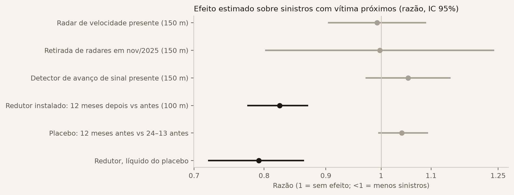

> **Status:** rascunho. Seções marcadas como *planejado* descrevem método, não resultados.
> Números gerados por `bhtraffic.export.site` e `bhtraffic.viz.figures` em 2026-10-16.

# Introdução

Belo Horizonte registrou, em 2025, **13.887 sinistros de trânsito com vítima — 38 por dia** —, o maior número
desde 2014, e **148 sinistros com morte**; em 2024 foram 154, o maior número desde 2014. O objetivo deste trabalho é duplo: (i) construir um diagnóstico
reprodutível do trânsito da cidade e da Região Metropolitana (RMBH), segmentado por área, horário e tipo
de usuário da via; e (ii) avaliar, com dados reais e simulação, intervenções baseadas em aprendizado de máquina.

# Dados

| Fonte | Período | Uso |
|---|---|---|
| Sinistros com vítima — ocorrências, veículos e pessoas [@pbh_sinistros] | 2011–2024 | quem, mix veicular |
| Sinistros com vítima — base mensal georreferenciada (PBH) | 2016–ago/2026 | diagnóstico, risco, intervenções |
| Fiscalização eletrônica — 51 retratos mensais (PBH) | jun/2022–set/2026 | presença de radares por ponto |
| Redutores de velocidade (PBH) | implantação 2006–2025 | antes/depois |
| Contagem volumétrica de radares [@pbh_radares] | mar/2021–set/2023 (31 meses) | volume, velocidade, mix veicular |
| GPS dos ônibus em tempo real (PBH) | coleta própria | velocidade comercial |
| TomTom Routing | coleta própria (cota grátis) | tempo de viagem por corredor |
| OpenStreetMap; grade H3 res. 8 [@h3] | snapshot 2026 | malha viária, agregação espacial |
| INMET, estação A521 Pampulha [@inmet] | 2011–2026, horária | chuva |
| Feriados nacionais, MG e BH (pacote `holidays` + leis municipais) | 2011–2026 | calendário |
| Brasileirão Série A [@brasileirao_dataset] | 2012–2024 | jogos em BH |

O tratamento dos dados está documentado em `docs/data_audit.md`. Destacam-se: unificação de nomes de colunas
que mudam entre anos; conversão das coordenadas de 2011–2015 para o padrão UTM dos anos seguintes; e remoção
do mapa de 6.618 registros com geocódigo padrão (um mesmo ponto atribuído a cinco ou mais regionais).

# Diagnóstico preliminar

## A década

{#fig-yearly}

Os sinistros com vítima caíram de 16.288 (2011) para 10.623 (2020) e voltaram a subir, chegando a 13.887 em 2025.
Os sinistros com morte (ao menos uma vítima fatal) tiveram mínimo de 98 em 2019, subiram para 154 em 2024 e ficaram
em 148 em 2025 (@fig-yearly). A série usa sinistros com morte, não número de mortos, porque a base mensal
(2016 em diante) não traz as pessoas envolvidas; de 2016 a 2024 as duas bases coincidem boletim a boletim.

## Quando

{#fig-clock}

De segunda a sexta, os sinistros concentram-se em dois picos — **7h e 18h** —, coincidindo com os deslocamentos
casa–trabalho. A pior hora da semana é **quarta-feira às 18h**, com 833 sinistros em cinco anos (@fig-clock).

## Onde

{#fig-regionals}

Em 2021–2025 a **Pampulha passou a liderar** tanto em sinistros com vítima (9.283, contra 8.963 da Centro-Sul)
quanto em sinistros com morte (111, contra 54 da Centro-Sul). O hexágono mais crítico da Pampulha fica sobre a Av. Antônio Carlos (@fig-regionals).

## Quem

{#fig-users}

**75 % dos sinistros com vítima envolvem ao menos uma motocicleta.** Das 638 mortes em 2020–2024,
motociclistas (48 %) e pedestres (32 %) somam 80 % (@fig-users).

**Exposição.** Nos 31 meses de radares da BHTrans (mar/2021–set/2023), em 80 pontos com contagem por classe
(70.516 ponto-dias; 1,92 bilhão de passagens), motos são **13,2 %** das passagens, mas estão em **76,6 %** dos
sinistros com vítima a até 100 m desses pontos nos mesmos dias. Por milhão de passagens, são 3,75 sinistros com moto
contra 0,17 sem moto: **razão de taxas de 21** (IC 95 % 18–25, *bootstrap* por ponto). É uma comparação de exposição
por área, não de risco por viagem: um sinistro perto do radar pode envolver veículos que não passaram por ele, e a
classificação dos radares pode subcontar motos que trafegam entre faixas (o que inflaria a razão).

# Congestionamento nos radares

Para cada radar da BHTrans, a velocidade de fluxo livre é a mediana da velocidade média dos carros entre 0h e 5h;
o **índice de velocidade** é a velocidade de cada hora dividida por ela (1 = livre; < 0,7 = congestionado).
Com os **31 meses de radares (mar/2021–set/2023; 917 dias, 89 pontos × sentido)**, ordenando os pontos pelo número
de horas de dia útil com índice < 0,7, os mais travados são: Av. Teresa Cristina (n.º 888, sentido Centro; **9 horas**
congestionadas, pior 0,44 às 8h), Av. Amazonas (n.º 3.984, sentido Centro; pior índice da cidade, **0,26 às 8h**),
Av. Cristiano Machado (n.º 12.001, sentido Centro; 0,59 às 18h), Av. Nossa Senhora do Carmo (0,37 às 8h) e
Av. do Contorno (0,49 às 17h). No sentido bairro, a Av. Cristiano Machado junto ao Viaduto Paulo Mendes Campos cai
para 0,34 às 17h. Os radares cobrem só os pontos onde há equipamento da BHTrans — não é um mapa da cidade inteira —,
e 2021 ainda tem efeito da pandemia.

# Quando o risco muda: feriados, jogos e chuva

**Desenho.** Uma linha por hora de 2011 a agosto de 2026 (137.328 horas, 207.248 sinistros com hora informada).
GLM de Poisson (erros-padrão agrupados por dia, robustos a sobredispersão) com efeitos fixos de dia da semana × hora (168), mês, ano e período de restrições da pandemia
(18/03/2020–30/06/2021). Cada coeficiente é uma **razão de taxas** (RT) contra horas comparáveis sem o evento.
Feriados nacionais, de MG e municipais de BH; jogos da Série A nos estádios de BH (2012–2024, 310 partidas, 19 clássicos;
janela de 2 h antes a 3 h depois do início); chuva horária da estação INMET A521 (Pampulha), alinhada à hora em que caiu (o INMET registra o total da hora que termina no horário).

{#fig-effects}

- **Chuva:** hora com chuva tem **+13,6 %** de sinistros (RT 1,136; IC 95 % 1,10–1,17). A **primeira chuva após
  72 h de tempo seco** acrescenta **+19 %** (RT 1,19; 1,09–1,30), ≈ +35 % no total — compatível com a película de óleo
  e poeira na pista. Chuva forte (≥ 5 mm) não acrescenta além disso.
- **Feriados:** −31 % (RT 0,69); Carnaval −44 %; ponto facultativo −15 %; dia seguinte ao feriado −10 %.
  Véspera de feriado não difere de um dia comum.
- **Jogos** (2012–2024, período coberto pela base de partidas): **nenhum efeito detectável** na cidade (RT 1,02; 0,98–1,06) nem num raio de 1,5 km dos estádios
  (Mineirão RT 1,03; 0,73–1,46; Independência RT 1,00; 0,61–1,63 — intervalos largos: 33 e 20 sinistros em janelas
  de jogo; Arena MRV, aberta em 2023, ainda sem dados suficientes).

**Cautela.** Menos sinistros em feriados reflete sobretudo **menos tráfego**, não ruas mais seguras por veículo;
o volume dos radares separa exposição de risco por classe de veículo (seção *Quem*), mas ainda não por hora. A base de jogos cobre só a Série A: Mineiro, Copa do Brasil,
Libertadores e Série B (Cruzeiro em 2020–2022) ficam de fora, o que dilui um eventual efeito.

# Risco de sinistro

**Pergunta.** Quantos sinistros com vítima esperar em cada hexágono H3 (res. 8, ~0,7 km²) em cada hora da semana?
**Desenho.** 429 células × 7 dias × 24 h = 72.072 célula-horários. As variáveis usam só anos anteriores ao ano-alvo
(sem vazamento): treino prevê 2024 com histórico 2019–2023; **teste prevê 2025** com histórico 2020–2024.
Ficam fora sinistros sem coordenada, sem hora ou no ponto padrão de geocodificação (restam 13.403 em 2025).
**Modelos.** LightGBM com perda de Poisson [@ke2017lightgbm], com histórico (v0) e com 14 variáveis de malha viária
do OpenStreetMap escolhidas antes de olhar o teste (v1), contra duas linhas de base: (a) média dos últimos 3 anos do
mesmo célula-horário; (b) taxa anual da célula × perfil horário da cidade.

{#fig-risk-capture}

| 2025 (teste) | Top 1 % | Top 5 % | Top 10 % | Deviance de Poisson |
|---|---|---|---|---|
| LightGBM v1 (histórico + OSM) | 6,9 % | 23,3 % | 37,6 % | 0,522 |
| LightGBM v0 (histórico) | 6,8 % | 23,2 % | 37,5 % | 0,523 |
| Taxa da célula × perfil horário | 6,8 % | 22,7 % | 37,1 % | 0,537 |
| Média 3 anos do célula-horário | 5,2 % | 17,7 % | 28,8 % | 3,29¹ |

: Fração dos sinistros de 2025 capturada ao priorizar os k % célula-horários de maior risco previsto. ¹ Inflada por previsões zero em célula-horários sem histórico. {#tbl-risk}

**Resultado.** O risco é concentrado: **5 % dos célula-horários reúnem 23 % dos sinistros** (4,6× o acaso),
10 % reúnem 37 % (@fig-risk-capture). Em 2025, o LightGBM **ajusta melhor** que a linha de base (b) — IC 95 % da
diferença de deviance [−0,020; −0,011], *bootstrap* por célula com 500 réplicas —, mas **empata na métrica de
priorização**: captura no top 5 % [−0,2; +0,9] p.p. Testado antes em 2024, o empate era nas duas métricas.
A malha do OSM (v1) não acrescenta nada ao histórico (diferença para v0: deviance [−0,002; +0,000], top 5 %
[−0,3; +0,4] p.p.). O risco é quase separável em *onde* × *quando*; o SHAP confirma: taxa da célula e perfil
horário dominam (@fig-risk-shap).

{#fig-risk-shap}

**Implicação.** Para escolher *onde* agir, um ranking transparente (taxa × perfil) basta; o modelo ganha ao estimar
*quanto* esperar. Ganho real de priorização deve vir de variáveis de **exposição** (volume e velocidade dos radares)
e de intervenções medidas (próxima seção), não de um modelo maior.

# Radares e redutores: o que mudou perto deles

**Dados.** A PBH publica a localização dos equipamentos de fiscalização eletrônica em retratos mensais
(51 desde jun/2022) e a data de implantação de cada redutor de velocidade. Equipamentos da mesma família a menos de
50 m formam um *ponto*; a presença de cada ponto é acompanhada mês a mês. Entre out/2025 e nov/2025 o cadastro caiu
de 669 para 163 equipamentos (radares de velocidade: 142 → 66) e se recompôs ao longo de 2026, muitas vezes em outros
locais — padrão compatível com troca de contrato, não confirmada aqui.

**Desenho (fixado antes dos resultados).** Radares: painel ponto × mês (jun/2022–ago/2026), desfecho = sinistros com
vítima a até 150 m; Poisson com efeito fixo de ponto e de mês (absorve chuva, feriados, tendência da cidade), erros
agrupados por ponto; o efeito vem dos pontos que ganharam ou perderam equipamento. Estudo de evento da retirada de
nov/2025 (pontos que perderam o radar × pontos que o mantiveram). Redutores: sinistros a até 100 m nos 12 meses depois
× 12 meses antes da implantação, cada janela relativa ao total da cidade no mesmo período (razão de razões), com
*placebo* uma janela antes (24–13 × 12–1 meses antes), para medir a volta à média de quem instala depois de um pico.

{#fig-interventions}

| Intervenção | Pontos | Efeito (IC 95 %) |
|---|---|---|
| Radar de velocidade presente | 144 (116 mudaram) | ×1,00 [0,92–1,10] |
| Retirada de radares em nov/2025 (DiD) | 72 perderam × 29 mantiveram | ×0,99 [0,80–1,22] |
| Detector de avanço de sinal presente | 123 | ×1,05 [0,97–1,14] |
| Redutor: depois × antes | 2.627 (2013–2025) | ×0,82 [0,78–0,87] |
| Redutor: placebo (antes × mais antes) | | ×1,04 [0,99–1,09] |
| **Redutor, líquido do placebo** | | **×0,79 [0,72–0,87]** |

: Efeito sobre sinistros com vítima nas proximidades (radares 150 m; redutores 100 m), jun/2022–ago/2026 (radares) e 2012–ago/2026 (redutores). {#tbl-enf}

**Resultado.** Os **redutores de velocidade** estão associados a **cerca de 21 % menos sinistros com vítima** a até
100 m (@fig-interventions), e o placebo mostra só um aumento pequeno e não significativo antes da instalação — a
queda não é explicada por volta à média. Para **radares de velocidade** e **detectores de avanço de sinal**, o efeito
não se distingue de zero na escala de 150 m; a retirada em massa de nov/2025 também não mostrou piora detectável em
10 meses. Esta última leitura é **frágil**: o estudo de evento rejeita tendências paralelas antes da retirada
(p = 0,005), e o cadastro mostra onde o equipamento está registrado, não se estava multando.

**Robustez.** (i) Em 2024 a PBH deixou de usar geocódigos padrão (até 2023, centenas de sinistros por ano caíam num
mesmo ponto do Anel; ver `docs/data_audit.md`). Restrito ao período com geocodificação consistente (2024 em diante),
o efeito do radar de velocidade fica em ×0,92 [0,84–1,01] (p = 0,09): indício de redução, não significativo.
Para os redutores, usando só janelas inteiramente de um lado da mudança: ×0,80 [0,72–0,89].
(ii) O intervalo dos redutores vem de *bootstrap* por projeto operacional (2.176 grupos; sem projeto, agrupados a 200 m),
porque redutores do mesmo projeto ficam na mesma rua e seus raios se sobrepõem.

**Cautela.** Ausência de efeito detectável não é prova de ausência de efeito: radares agem sobre velocidade em trechos
longos e sobre gravidade (não só número) dos sinistros, e o raio de 150 m pode não capturar isso. As contagens da
BHTrans terminam em set/2023, antes da retirada de nov/2025, e não permitem medir o efeito dos equipamentos sobre a
velocidade; servem como linha de base de velocidade (cenário abaixo).

# Cenários "e se" de segurança

**Regras.** Cada cenário usa um efeito **medido** neste estudo (com IC) ou uma **premissa** explícita; a incerteza é
propagada por Monte Carlo (5.000 sorteios: efeito log-normal ajustado ao IC 95 %, linha de base Poisson) e
reportada como intervalo de 90 %. Linha de base: sinistros de 2024-09-01 a 2026-08-31 (período com
geocodificação consistente), anualizados. O site traz a versão interativa.

**Redutores nos pontos de maior sinistralidade.** Só onde o efeito foi medido: ≥ 90 % dos sinistros a até 100 m em
ruas locais (os redutores medidos estão 94 % em vias residenciais ou terciárias) e taxa ≤ 7,2
sinistros/ano (99º percentil em volta dos redutores medidos); sem redutor existente a 100 m; pontos a ≥ 200 m entre si.

| Cenário | Sinistros/ano a até 100 m (hoje) | Evitados/ano, mediana (90 %) |
|---|---|---|
| 10 redutores | 70 | 14 (9–20) |
| 50 redutores | 320 | 66 (45–87) |
| 100 redutores | 571 | 118 (81–153) |
| 200 redutores | 952 | 198 (135–254) |
| 500 redutores | 1.661 | 347 (236–444) |

: Efeito aplicado: ×0,79 [0,72–0,87] (redutor, líquido do placebo). {#tbl-whatif}

**Radares de volta nos 37 pontos ainda sem equipamento** (retirados em nov/2025): 370
sinistros/ano a até 150 m. Com o efeito do período todo, evitados −1 (−30 a 26) —
a faixa inclui zero; com o efeito desde 2024, 28 (1–53): a faixa de 90 % fica acima de zero, mas o efeito em si
não é significativo a 95 % (p = 0,09). **Não há base para prometer resultado.**

**Primeira chuva após 72 h secos.** ~18 horas/ano, com ~45
sinistros; o excesso atribuível a ser a primeira chuva é 7 (4–11) sinistros/ano, e o
excesso de toda hora com chuva (~406 h/ano) é 82 (67–97). Uma ação
(alerta, fiscalização, limpeza de pista) que elimine uma fração *p* desse excesso evita *p* × esse número — *p* é premissa.

**Velocidade média nas avenidas com radar.** Nos 80 pontos com velocidade medida (média ponderada 44 km/h), há
463 sinistros/ano a até 100 m. Supondo que os sinistros respondam à velocidade média pelo *Power Model*
[@nilsson2004power] — razão = (v₁/v₀)^k^, com *k* sorteado entre 1,5 e 2,5 (**premissa**, não medida aqui) —, reduzir a
velocidade média dos carros em 1 km/h evitaria 21 (16–26) sinistros/ano; em 5 km/h, 100 (78–122); em 10 km/h,
186 (152–223). A velocidade é medida; a resposta dos sinistros e o meio de obter a redução não são.

**Leitura.** Redutores em ruas locais são a alavanca com efeito medido; ganhos maiores exigiriam atuar nas vias
arteriais, onde o efeito de redutores **não** foi medido e onde entram os cenários de infraestrutura (SUMO, F10).

# Microssimulação (em andamento)

Um piloto SUMO [@lopez2018sumo] da Av. Antônio Carlos (Lagoinha–Pampulha, 7–8h) foi montado com a malha do OSM e demanda
ajustada às contagens dos radares da BHTrans (`routeSampler`). Após três iterações, **ainda não atinge o critério de
calibração** (GEH < 5; melhor resultado: GEH 41, erro de velocidade 13 km/h): faltam a configuração real de faixas
(inclusive as do MOVE), os tempos de semáforo e uma matriz origem-destino. Por isso nenhum resultado de cenário de
microssimulação é apresentado nesta versão; o diário de calibração está em `docs/roadmap.md`.

# Métodos de aprendizado de máquina (planejado)

1. **Previsão de congestionamento.** Redes em grafo espaço-temporais [@li2018dcrnn; @yu2018stgcn; @wu2019graphwavenet]
   para prever velocidade por trecho 15–60 min à frente, com radares, TomTom e GPS dos ônibus. Linha de base: média histórica
   por trecho × hora e modelo sazonal ingênuo. Validação *walk-forward*.
2. **Risco de sinistro (v1).** Mesmo desenho da seção anterior, explicado com SHAP [@lundberg2017shap],
   acrescentando variáveis de exposição (radares, TomTom) e de geometria viária (OSM).
3. **Semáforos adaptativos.** Aprendizado por reforço em microssimulação SUMO [@lopez2018sumo] de áreas piloto,
   comparado a planos de tempo fixo (atraso médio, filas, paradas).
4. **Prioridade para ônibus.** Cenários de faixa exclusiva e prioridade semafórica avaliados com GPS real da frota.

# Simulação (planejado)

Duas camadas: microssimulação SUMO em três pilotos (Hipercentro/Contorno; Antônio Carlos × Pampulha; Anel entre
BR-040 e Cristiano Machado), calibrada com radares e tempos de viagem; e uma camada macro/meso para cenários de
política em BH, alimentada pela Pesquisa Origem-Destino da RMBH.

# Limitações

- A base cobre apenas sinistros **com vítima**.
- 14,6 % dos sinistros não têm coordenada válida; ficam fora do mapa, mas contam nos totais.
- As contagens de radares terminam em set/2023, têm meses incompletos (ex.: ago/2021 com 10 dias) e cobrem só os pontos com equipamento da BHTrans.
- Os dados de tempo de viagem dependem da coleta própria, iniciada em 2026; 5 dos 18 corredores TomTom têm rota
  1,7–2,2× a linha de referência (possível desvio do eixo) e estão em revisão.
- Variáveis do OSM são de 2026, aplicadas a sinistros de 2011–2025.
- A base mensal (2016 em diante) não traz pessoas nem veículos: análises por tipo de usuário param em 2024.
- O cadastro de fiscalização eletrônica indica onde um equipamento está registrado, não se estava em operação.
- Jogos: só Série A; chuva: uma estação (Pampulha) para a cidade toda.

# Referências {.unnumbered}

::: {#refs}
:::
