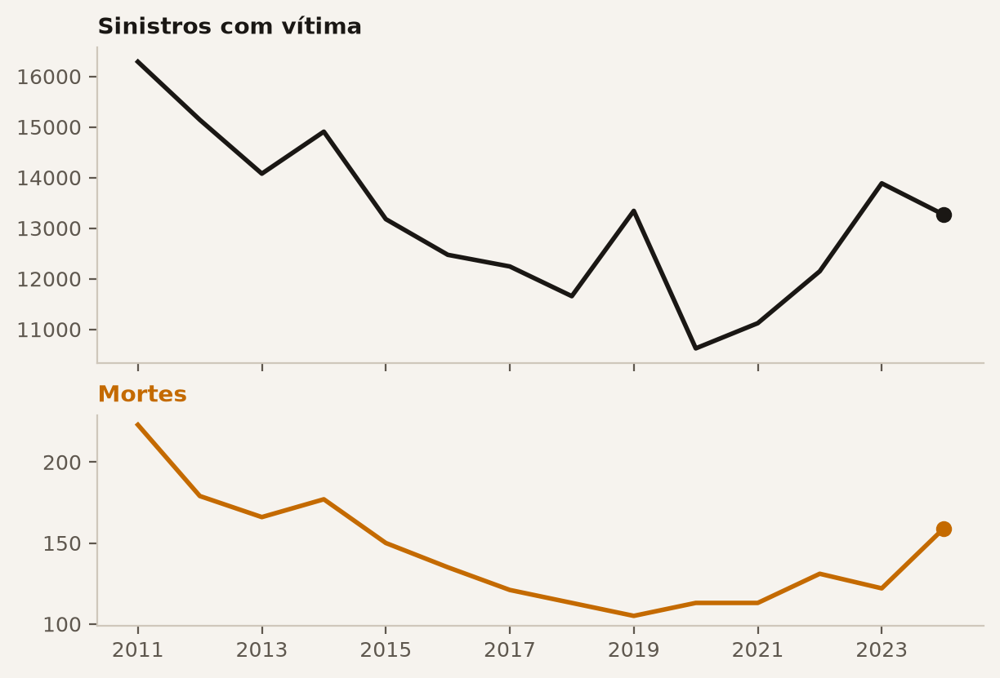
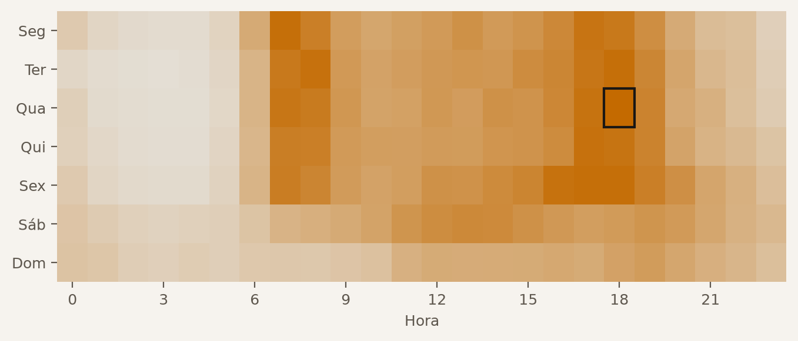
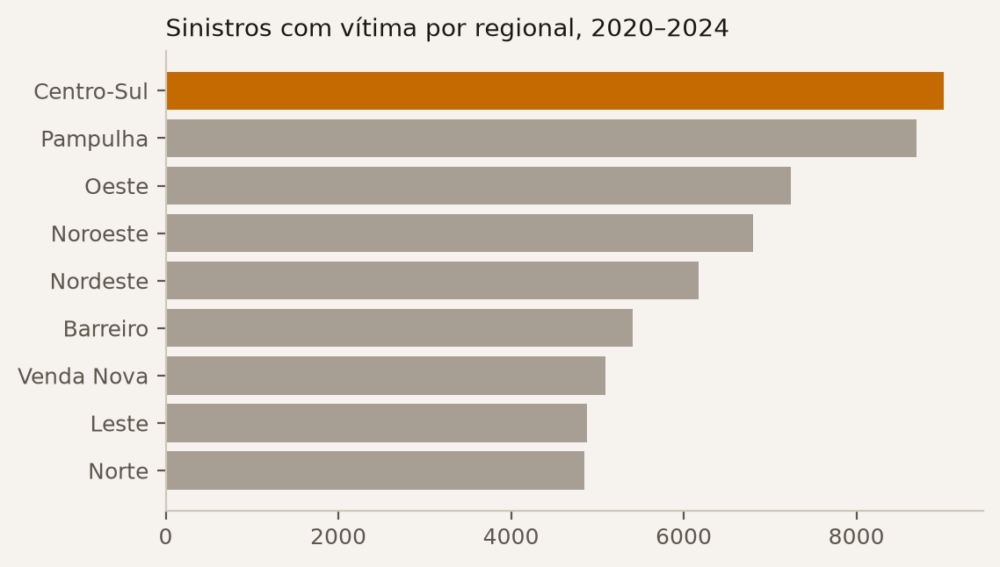
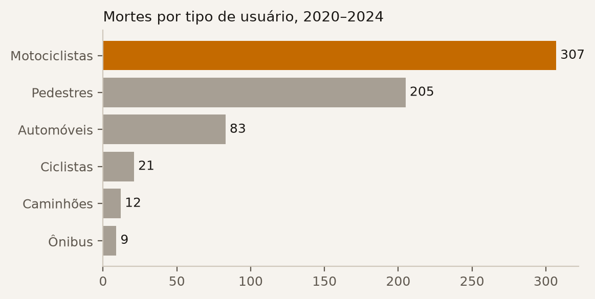
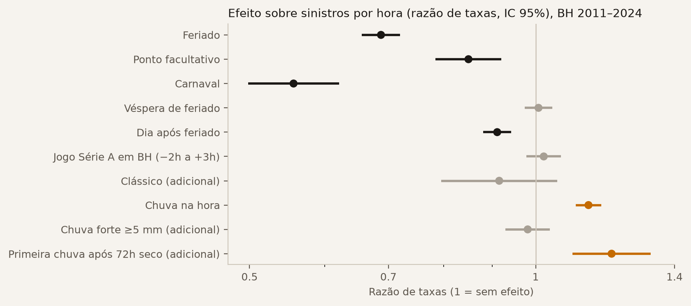
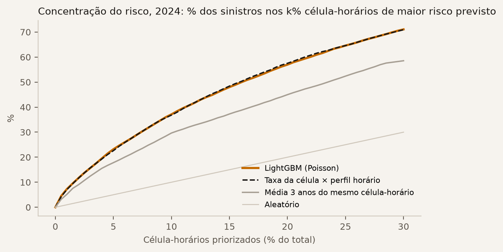
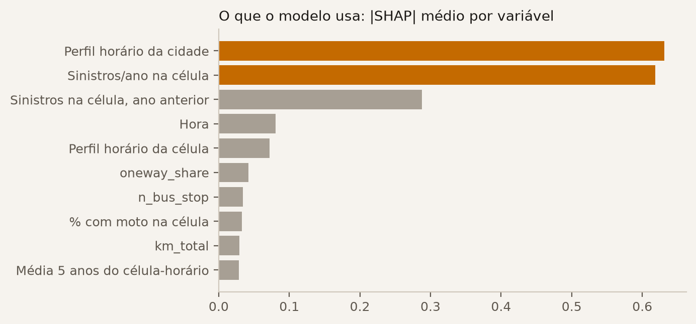

> **Status:** rascunho. Seções marcadas como *planejado* descrevem método, não resultados.
> Números gerados por `bhtraffic.export.site` e `bhtraffic.viz.figures` em 2026-10-13.

# Introdução

Belo Horizonte registrou, em 2024, **13.266 sinistros de trânsito com vítima — 36 por dia** —
e **159 mortes**, o maior número desde 2014. O objetivo deste trabalho é duplo: (i) construir um diagnóstico
reprodutível do trânsito da cidade e da Região Metropolitana (RMBH), segmentado por área, horário e tipo
de usuário da via; e (ii) avaliar, com dados reais e simulação, intervenções baseadas em aprendizado de máquina.

# Dados

| Fonte | Período | Uso |
|---|---|---|
| Sinistros com vítima — ocorrências, veículos e pessoas [@pbh_sinistros] | 2011–2024 | diagnóstico, risco |
| Contagem volumétrica de radares [@pbh_radares] | 2021–2023 | volume, velocidade, mix veicular |
| GPS dos ônibus em tempo real (PBH) | coleta própria | velocidade comercial |
| TomTom Routing | coleta própria (cota grátis) | tempo de viagem por corredor |
| OpenStreetMap; grade H3 res. 8 [@h3] | snapshot 2026 | malha viária, agregação espacial |
| INMET, estação A521 Pampulha [@inmet] | 2011–2024, horária | chuva |
| Feriados nacionais, MG e BH (pacote `holidays` + leis municipais) | 2011–2024 | calendário |
| Brasileirão Série A [@brasileirao_dataset] | 2012–2024 | jogos em BH |

O tratamento dos dados está documentado em `docs/data_audit.md`. Destacam-se: unificação de nomes de colunas
que mudam entre anos; conversão das coordenadas de 2011–2015 para o padrão UTM dos anos seguintes; e remoção
do mapa de 6.618 registros com geocódigo padrão (um mesmo ponto atribuído a cinco ou mais regionais).

# Diagnóstico preliminar

## A década

{#fig-yearly}

Os sinistros com vítima caíram de 16.288 (2011) para 10.624 (2020) e voltaram a subir, chegando a 13.266 em 2024.
As mortes seguiram trajetória parecida, com mínimo de 105 em 2019 e 159 em 2024 (@fig-yearly).

## Quando

{#fig-clock}

De segunda a sexta, os sinistros concentram-se em dois picos — **7h e 18h** —, coincidindo com os deslocamentos
casa–trabalho. A pior hora da semana é **quarta-feira às 18h**, com 786 sinistros em cinco anos (@fig-clock).

## Onde

{#fig-regionals}

A Centro-Sul lidera em número de sinistros (9.014 em 2020–2024), mas a **Pampulha concentra mais sinistros fatais**
(107 contra 58 da Centro-Sul). O hexágono mais crítico da Pampulha fica sobre a Av. Antônio Carlos (@fig-regionals).

## Quem

{#fig-users}

**75 % dos sinistros com vítima envolvem ao menos uma motocicleta.** Das 638 mortes em 2020–2024,
motociclistas (48 %) e pedestres (32 %) somam 80 % (@fig-users).

**Exposição (preliminar).** Na primeira amostra dos radares da BHTrans — 10 dias de agosto de 2021, 88 pontos,
12,4 milhões de veículos detectados — motos são **12,5 %** do fluxo. A desproporção entre presença no tráfego e
presença nos sinistros com vítima é o ponto de partida do modelo de risco. Ressalvas: amostra curta, e a classificação
dos radares pode subcontar motos que trafegam entre faixas.

# Congestionamento nos radares (preliminar)

Para cada radar da BHTrans, a velocidade de fluxo livre é a mediana da velocidade média dos carros entre 0h e 5h;
o **índice de velocidade** é a velocidade de cada hora dividida por ela (1 = livre; < 0,7 = congestionado).
Na amostra disponível — **10 dias de agosto de 2021, 88 radares**, ainda sob efeito da pandemia — os piores pontos em
dia útil são a Av. Cristiano Machado junto ao Viaduto Paulo Mendes Campos (índice 0,36 às 17h), a Av. Raja Gabaglia
(0,31 às 18h), a Av. Teresa Cristina (0,39 às 17h) e, no pico da manhã, Andradas, Amazonas e Antônio Carlos.
Estes números serão refeitos com os 31 meses de radares (mar/2021–set/2023) e não devem ser lidos como ranking final.

# Quando o risco muda: feriados, jogos e chuva

**Desenho.** Uma linha por hora de 2011 a 2024 (122.736 horas, 184.304 sinistros com hora informada).
GLM de Poisson (erros-padrão agrupados por dia, robustos a sobredispersão) com efeitos fixos de dia da semana × hora (168), mês, ano e período de restrições da pandemia
(18/03/2020–30/06/2021). Cada coeficiente é uma **razão de taxas** (RT) contra horas comparáveis sem o evento.
Feriados nacionais, de MG e municipais de BH; jogos da Série A nos estádios de BH (2012–2024, 310 partidas, 19 clássicos;
janela de 2 h antes a 3 h depois do início); chuva horária da estação INMET A521 (Pampulha), alinhada à hora em que caiu (o INMET registra o total da hora que termina no horário).

{#fig-effects}

- **Chuva:** hora com chuva tem **+13,6 %** de sinistros (RT 1,136; IC 95 % 1,10–1,17). A **primeira chuva após
  72 h de tempo seco** acrescenta **+20 %** (RT 1,20; 1,09–1,32), ≈ +37 % no total — compatível com a película de óleo
  e poeira na pista. Chuva forte (≥ 5 mm) não acrescenta além disso.
- **Feriados:** −31 % (RT 0,69); Carnaval −44 %; ponto facultativo −15 %; dia seguinte ao feriado −9 %.
  Véspera de feriado não difere de um dia comum.
- **Jogos:** **nenhum efeito detectável** na cidade (RT 1,02; 0,98–1,06) nem num raio de 1,5 km dos estádios
  (Mineirão RT 1,03; 0,73–1,46; Independência RT 1,00; 0,61–1,63 — intervalos largos: 33 e 20 sinistros em janelas
  de jogo; Arena MRV, aberta em 2023, ainda sem dados suficientes).

**Cautela.** Menos sinistros em feriados reflete sobretudo **menos tráfego**, não ruas mais seguras por veículo;
o volume dos radares permitirá separar exposição de risco. A base de jogos cobre só a Série A: Mineiro, Copa do Brasil,
Libertadores e Série B (Cruzeiro em 2020–2022) ficam de fora, o que dilui um eventual efeito.

# Risco de sinistro: primeiro resultado

**Pergunta.** Quantos sinistros com vítima esperar em cada hexágono H3 (res. 8, ~0,7 km²) em cada hora da semana?
**Desenho.** 427 células × 7 dias × 24 h = 71.736 célula-horários. As variáveis usam só anos anteriores ao ano-alvo
(sem vazamento): treino prevê 2023 com histórico 2018–2022; teste prevê 2024 com histórico 2019–2023.
Ficam fora sinistros sem coordenada, sem hora ou no ponto padrão de geocodificação (restam 12.081 em 2024).
**Modelos.** LightGBM com perda de Poisson [@ke2017lightgbm] contra duas linhas de base: (a) média dos últimos 3 anos
do mesmo célula-horário; (b) taxa anual da célula × perfil horário da cidade.

{#fig-risk-capture}

| 2024 (teste) | Top 1 % | Top 5 % | Top 10 % | Deviance de Poisson |
|---|---|---|---|---|
| LightGBM | 7,3 % | 23,0 % | 37,2 % | 0,507 |
| Taxa da célula × perfil horário | 7,1 % | 22,6 % | 36,8 % | 0,509 |
| Média 3 anos do célula-horário | 5,5 % | 18,1 % | 29,6 % | 3,14¹ |

: Fração dos sinistros de 2024 capturada ao priorizar os k % célula-horários de maior risco previsto. ¹ Inflada por previsões zero em célula-horários sem histórico. {#tbl-risk}

**Resultado.** O risco é concentrado: **5 % dos célula-horários reúnem 23 % dos sinistros** (4,6× o acaso),
10 % reúnem 37 % (@fig-risk-capture). Mas o LightGBM **empata** com a linha de base (b): no *bootstrap* por célula
(500 réplicas), o IC 95 % da diferença de deviance é [−0,007; +0,002] e o da captura no top 5 % é [−0,2; +0,9] p.p. —
ambos incluem zero. Com apenas o histórico de sinistros, o risco é quase separável em *onde* × *quando*;
o SHAP confirma: taxa da célula e perfil horário da cidade dominam (@fig-risk-shap).

{#fig-risk-shap}

**Versão v1 (OSM).** Acrescentar 14 variáveis de malha viária do OpenStreetMap (km por classe de via, cruzamentos,
semáforos, faixas de pedestre, pontos de ônibus, rotatórias, faixas, limite de velocidade, mão única), escolhidas
antes de olhar 2024, **também empata** (diferença para v0: deviance [−0,0002; +0,0018], top 5 % [−0,3; +0,4] p.p.).
O histórico da célula já carrega a estrutura viária; o OSM só ajudaria em áreas sem histórico.

**Implicação.** Para priorizar fiscalização e engenharia hoje, um ranking transparente (taxa × perfil) basta.
Ganho de ML deve vir de **novas variáveis exógenas** — volume e velocidade dos radares, atraso do TomTom,
geometria viária do OpenStreetMap —, não de um modelo maior. Próximo passo: repetir com essas variáveis
e modelar separadamente sinistros com moto e atropelamentos.

# Métodos de aprendizado de máquina (planejado)

1. **Previsão de congestionamento.** Redes em grafo espaço-temporais [@li2018dcrnn; @yu2018stgcn; @wu2019graphwavenet]
   para prever velocidade por trecho 15–60 min à frente, com radares, TomTom e GPS dos ônibus. Linha de base: média histórica
   por trecho × hora e modelo sazonal ingênuo. Validação *walk-forward*.
2. **Risco de sinistro (v1).** Mesmo desenho da seção anterior, explicado com SHAP [@lundberg2017shap],
   acrescentando variáveis de exposição (radares, TomTom) e de geometria viária (OSM).
3. **Semáforos adaptativos.** Aprendizado por reforço em microssimulação SUMO [@lopez2018sumo] de áreas piloto,
   comparado a planos de tempo fixo (atraso médio, filas, paradas).
4. **Prioridade para ônibus.** Cenários de faixa exclusiva e prioridade semafórica avaliados com GPS real da frota.

# Simulação (planejado)

Duas camadas: microssimulação SUMO em três pilotos (Hipercentro/Contorno; Antônio Carlos × Pampulha; Anel entre
BR-040 e Cristiano Machado), calibrada com radares e tempos de viagem; e uma camada macro/meso para cenários de
política em BH, alimentada pela Pesquisa Origem-Destino da RMBH.

# Limitações

- A base cobre apenas sinistros **com vítima**.
- 14,6 % dos sinistros não têm coordenada válida; ficam fora do mapa, mas contam nos totais.
- As contagens de radares terminam em set/2023 e têm meses incompletos.
- Os dados de tempo de viagem dependem da coleta própria, iniciada em 2026; 5 dos 18 corredores TomTom têm rota
  1,7–2,2× a linha de referência (possível desvio do eixo) e estão em revisão.
- Variáveis do OSM são de 2026, aplicadas a sinistros de 2011–2024.
- Jogos: só Série A; chuva: uma estação (Pampulha) para a cidade toda.

# Referências {.unnumbered}

::: {#refs}
:::
